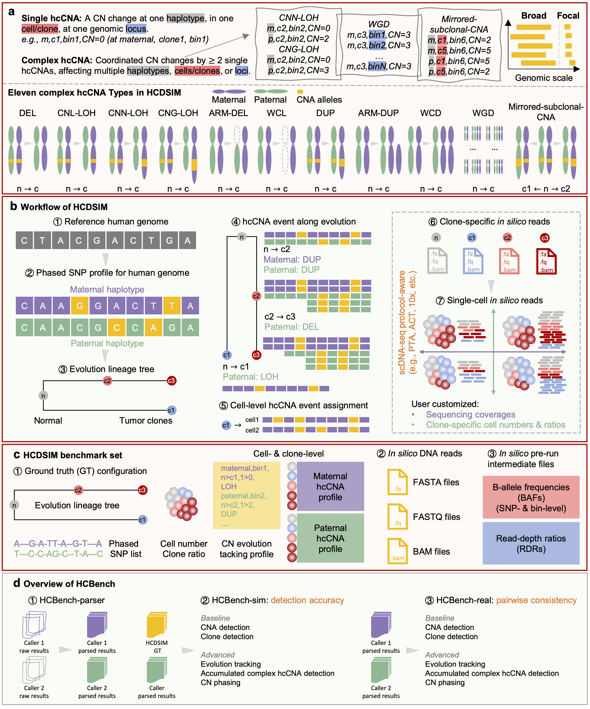

<p align="left">
  <a href="https://pypi.org/project/hcdsim/"></a>
  <a href="https://pepy.tech/project/hcdsim"></a>
  <a href="https://hcdsim.readthedocs.io"></a>
  <!-- <a href="https://doi.org/10.5281/zenodo.23060387"></a> -->
  <a href="https://github.com/BioThinkLab/HCDSIM/blob/main/LICENSE"></a>
  <a href="https://github.com/BioThinkLab/HCDSIM/stargazers"></a>
</p>

# HCDSIM

**A Single-Cell Genomics Simulator with Haplotype- and Clone-Specific Copy Number Annotation**

HCDSIM simulates single-cell DNA sequencing (scDNA-seq) data with ground-truth (GT) **haplotype-, cell/clone-, and locus-specific copy number alterations (hcCNAs)**. It models **eleven complex hcCNA types** along a tumor clonal lineage tree, records when each event arises and how it is inherited, and outputs reads (FASTA/FASTQ/BAM) and intermediate files (phased SNPs, BAFs, RDRs) in the formats that existing hcCNA callers take as input.

Together with its companion benchmarking framework **[HCBench](https://github.com/compbioclub/HCBench)**, HCDSIM provides a foundation for developing and evaluating hcCNA callers.



## Key features

- 🧬 **Eleven complex hcCNA types**, covering
  - *CN loss*: DEL, CNL-LOH, CNN-LOH, CNG-LOH, ARM-DEL, WCL
  - *CN gain*: DUP, ARM-DUP, WCD, WGD
  - *Mirror-like*: mirrored-subclonal-CNA (reciprocal CN swaps between haplotypes across clones)
  - at focal (< 3 Mb), medium (3–10 Mb), and broad (> 10 Mb) scales
- 🌳 **Clonal evolution**: lineage trees built with a beta splitting model (tunable from balanced to comb-like trees), with three clone-size allocation modes: *uniform*, *ancestral dominance*, and *evolved dominance*
- ⏱️ **Event onset tracking**: time-stamped logs of where each complex hcCNA first appears and whether descendant clones inherit it
- 👥 **Intra-clonal heterogeneity**: optional cell-specific private events (DEL, LOH, DUP) on top of the clone profile
- 📈 **Protocol-aware coverage bias**: coverage non-uniformity controlled by Lorenz-curve parameters to mimic PTA, ACT, 10x Genomics, and other protocols
- 📦 **Caller-ready outputs**: phased germline SNPs, normal cells, FASTQ, clone-level, cell-level, and barcoded BAMs, plus SNP- and bin-level BAFs and RDRs. These are the inputs required by CHISEL, Alleloscope, SIGNALS, SEACON, and CNRein
- ⚡ **Lightweight intermediate files**: start developing a caller from BAF/RDR matrices without heavy FASTQ/BAM processing

## Installation

```bash
pip install hcdsim
```

HCDSIM calls the following external tools, which must be available in your `PATH`:

- [wgsim](https://github.com/lh3/wgsim) (tested with v1.13)
- [BWA](https://github.com/lh3/bwa) (tested with v0.7.17)
- [samtools](https://github.com/samtools/samtools)

<!-- TODO: confirm the dependency list and Python version requirement -->

## Quick start

Run the full pipeline:

```python
from hcdsim import HCDSIM

sim = HCDSIM(ref_genome='hg38.fa', clone_no=10, cell_no=100, outdir='./demo')
sim.sim()
```

or from the command line with `hcdsim sim` (see `hcdsim sim --help`).

See the [documentation and tutorials](https://hcdsim.readthedocs.io) for full usage.

## Benchmarking with HCBench

**[HCBench](https://github.com/compbioclub/HCBench)** ([tutorials](https://compbioclub.github.io/HCBench)) is a standardized framework for benchmarking single-cell allele-specific (acCNA) and haplotype-specific (hcCNA) callers. It has three modules:

- **HCBench-parser**: converts raw caller outputs (CHISEL, Alleloscope, SIGNALS, SEACON, CNRein, ...) into standardized read-count/RDR/BAF matrices, acCNA/hcCNA profiles, cell- and clone-level profiles, and clone labels
- **HCBench-sim**: scores callers against HCDSIM ground truth
- **HCBench-real**: measures pairwise consistency between callers, and fit to observed read depth and allelic signal, on real data without ground truth

Both evaluation modules cover five perspectives (20 evaluation questions):
**CNA detection** · **clone detection** · **evolution tracking** · **accumulated complex hcCNA detection** · **CN phasing**

### Benchmark datasets

| Dataset | Design |
|---|---|
| **hcCNA-bench** | 10 clones (1 normal + 9 tumor), 1,000 cells, evolved dominance, coverages 0.01x / 0.02x / 0.05x / 0.1x / 0.2x |
| **hcCNA-bench-tree** | 5 datasets at 0.02x, 1,000 cells: 10-clone and 6-clone trees under uniform, ancestral, and evolved dominance modes |

All simulated datasets, including GT haplotype- and clone-specific CN profiles and single-cell reads, are available on Zenodo: [10.5281/zenodo.21167429](https://doi.org/10.5281/zenodo.21167429).

## Citation

> 📝 The manuscript is currently under review. This section will be updated once it is published.

If you use HCDSIM, HCBench, or the hcCNA-bench datasets, please cite:

```bibtex
@article{feng2026hcdsim,
  title   = {Benchmarking of haplotype- and clone-specific detection callers of complex copy number alterations in single-cell DNA-sequencing with HCDSIM and HCBench},
  author  = {Feng, Xikang and Jiang, Anna and Peng, Sisi and Jin, Qiangguo and He, Liang and Chen, Lingxi},
  journal = {TBD},
  year    = {2026},
  doi     = {TBD}
}
```

Software and data archives:

```bibtex
@software{hcdsim_zenodo,
  author    = {Feng, Xikang and Jiang, Anna and Peng, Sisi and Jin, Qiangguo and He, Liang and Chen, Lingxi},
  title     = {HCDSIM: A single-cell genomics simulator with haplotype- and clone-specific copy number annotation},
  year      = {2026},
  publisher = {Zenodo},
  doi       = {10.5281/zenodo.23060387}
}

@software{hcbench_zenodo,
  author    = {Feng, Xikang and Jiang, Anna and Peng, Sisi and Jin, Qiangguo and He, Liang and Chen, Lingxi},
  title     = {HCBench: A standardized benchmarking framework for single-cell haplotype- and clone-specific copy number alteration caller},
  year      = {2026},
  publisher = {Zenodo},
  doi       = {10.5281/zenodo.23386948}
}

@dataset{hccnabench_zenodo,
  author    = {Feng, Xikang and Jiang, Anna and Peng, Sisi and Jin, Qiangguo and He, Liang and Chen, Lingxi},
  title     = {hcCNA-bench and hcCNA-bench-tree: Benchmark datasets for evaluating haplotype- and clone-specific detection of complex copy number alterations in single-cell DNA sequencing},
  year      = {2026},
  publisher = {Zenodo},
  doi       = {10.5281/zenodo.21167430}
}
```

## Contact

- Xikang Feng: fxk@nwpu.edu.cn
- Lingxi Chen: lingxi.chen@cityu.edu.hk

Bug reports and feature requests are welcome via [GitHub Issues](https://github.com/BioThinkLab/HCDSIM/issues).

## License

HCDSIM is released under the [MIT License](LICENSE).